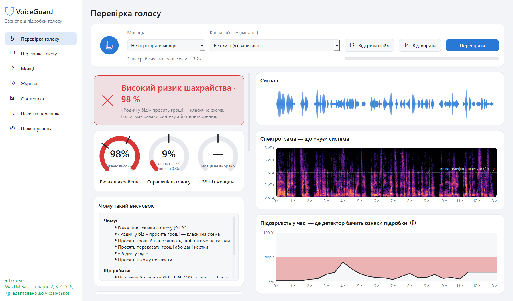

# VoiceGuard

**Програмна система виявлення шахрайських голосових повідомлень і дзвінків з підробленим голосом**

Кваліфікаційна робота магістра, спеціальність 122 «Комп'ютерні науки».
Чернівецький національний університет імені Юрія Федьковича, кафедра математичних проблем управління і кібернетики, 2026.
Виконавець — Веркаш Віталій Юрійович. Керівник — д. ф.-м. н., проф. Малик І. В.



## Що робить система

Шахраї клонують голос рідних із кількох секунд відео чи голосового й надсилають повідомлення «Мамо, я в біді, скинь гроші» або дзвонять «зі служби безпеки банку». VoiceGuard відповідає на три питання і зводить відповіді в одну оцінку ризику з причинами й порадами:

| Питання | Модуль | Метод |
|---|---|---|
| Голос справжній? | детектор підробки | ознаки самонавченої моделі **WavLM Base+** (шари 2–7) + логістична регресія, адаптовано до української |
| Чий це голос? | верифікація мовця | MFCC, **GMM-UBM** з MAP-адаптацією, реєстрація за 3–5 фразами |
| Що просять? | аналіз змісту | розпізнавання мовлення **Whisper** (faster-whisper small) + правила тактик шахраїв, перевірка посилань і номерів |

Ризик: `R = 1 − Π(1 − wᵢ·sᵢ)` → низький / середній / високий. Необов'язково — пояснення простими словами від локальної мовної моделі (Ollama, Gemma 3).
**Усе працює локально**: записи не залишають комп'ютер; одна перевірка триває 7–14 с на ноутбуці без відеокарти.

## Основні результати

| Що | Результат |
|---|---|
| Середній EER детектора на 10 каналах зв'язку (ASVspoof 2019 LA eval) | 34,3 % (базовий LFCC-GMM) → **7,4 %** (WavLM) |
| Частка підробок, що проходять верифікацію мовця | 71,9 % → **11,4 %** (з детектором у каскаді) |
| EER англомовного детектора на українських записах | **64 %** (гірше за вгадування) |
| Після адаптації на 118 парах українських записів | **3,2–7,0 %** (від 30 пар — 13 %) |
| Хибні тривоги аналізу змісту (1033 абзаци звичайних текстів UA-GEC) | **0,1 %** |
| Виявлено шахрайських розмов (перекладені діалоги) | 58 % без хибних тривог |
| Незалежна перевірка: Edge-TTS + RVC (DRSSU) проти FLEURS — синтезатори, яких не було в адаптації | EER 34,3 % → **1,0 %** |
| Незалежна перевірка: справжні дипфейки українських публічних осіб із соцмереж (ML-ITW) | **не виявляються** (17 з 17 пропущено) |
| Автоматичні тести ядра | 23 / 23 |

Детальні числа — у [results/](results/) (JSON/CSV) та в [docs/EXPERIMENTS.md](docs/EXPERIMENTS.md).

## Швидкий старт

Потрібно: Python 3.10+ (перевірено на 3.14), Windows / Linux / macOS, ≈ 2 ГБ вільного місця, інтернет для першого запуску.

```bash
git clone https://github.com/VitaliyVY/VoiceGuard.git
cd VoiceGuard
python -m venv .venv
.venv\Scripts\activate            # Linux/macOS: source .venv/bin/activate
pip install -r requirements.txt
```

Запуск десктопної програми:

```bash
python VoiceGuard.pyw
```

Перевірка з командного рядка (без інтерфейсу):

```bash
python examples/check.py audio demo/3_шахрайське_голосове.wav
python examples/check.py text "Вам нараховано виплату від Дії! Перейдіть: diia-vyplata.xyz"
```

Тести:

```bash
python -m unittest discover -s tests
```

Повний протокол встановлення й запуску — **[docs/INSTALL.md](docs/INSTALL.md)**, приклади з очікуваним результатом — **[docs/USAGE.md](docs/USAGE.md)**.

## Документація

| Документ | Зміст |
|---|---|
| [docs/INSTALL.md](docs/INSTALL.md) | протокол встановлення та запуску крок за кроком, ШІ-пояснення (Ollama), типові проблеми |
| [docs/USAGE.md](docs/USAGE.md) | приклади запуску: програма, командний рядок, Python API — з очікуваним виводом |
| [docs/ARCHITECTURE.md](docs/ARCHITECTURE.md) | архітектура, модулі, алгоритм ухвалення рішення, формат даних |
| [docs/EXPERIMENTS.md](docs/EXPERIMENTS.md) | дані, протокол експериментів і команди для відтворення всіх результатів роботи |
| [demo/Сценарій_відео.md](demo/Сценарій_відео.md) | сценарій демонстрації програми на файлах з `demo/` |

## Структура репозиторію

```
VoiceGuard.pyw        запуск десктопної програми
voiceguard/           пакет (ядро системи)
  audio.py            читання, передискретизація, відкидання тиші
  features.py         STFT, банки фільтрів, MFCC, LFCC, Δ/ΔΔ, CMVN (власна реалізація)
  channel.py          канали: Opus, G.711, AMR-NB/WB, GSM, шум
  metrics.py          EER, minDCF
  models.py           GMM-детектор, верифікація GMM-UBM з MAP-адаптацією
  cnn.py              LightCNN на LFCC (порівняльний детектор)
  ssl.py              ознаки WavLM Base+ (основний детектор)
  asr.py              розпізнавання мовлення (faster-whisper)
  scam.py             аналіз змісту: тактики, посилання, номери карток і телефонів
  risk.py             загальна оцінка ризику, причини, поради
  ai.py               пояснення локальною мовною моделлю (Ollama)
  system.py           прикладний рівень: перевірка, мовці, журнал
  qt_app.py, gui.py   інтерфейс PySide6 / запасний Tkinter
examples/check.py     перевірка з командного рядка
scripts/              експерименти (навчання, оцінювання, українські дані)
tests/                юніт-тести
models/               навчені моделі (≈ 10 МБ) — програма працює одразу після клонування
results/              результати експериментів (JSON, CSV, журнали запусків)
demo/                 демонстраційні записи (справжні — Common Voice CC0, синтез — Piper)
app_data/             дані програми (демо-мовець; журнал створюється при запуску)
docs/                 документація
```

## Дані та ліцензії

Код — [MIT](LICENSE). Набори даних у репозиторій не входять (див. [docs/EXPERIMENTS.md](docs/EXPERIMENTS.md)) і мають власні ліцензії:
ASVspoof 2019 LA (ODC-By), Common Voice 19 uk (CC0), голоси Piper uk_UA (rhasspy/piper-voices),
MMS-TTS ukr (CC BY-NC 4.0 — лише некомерційно), UA-GEC (CC BY 4.0), BothBosu/scam-dialogue (Apache-2.0).

## Обмеження

**Дипфейки, поширені в соцмережах, детектор не виявляє**: на українській частині ML-ITW (17 дипфейків Залужного, Данілова, Зеленського з Facebook і X) пропущено всі 17, EER 69,9 % ([docs/EXPERIMENTS.md](docs/EXPERIMENTS.md#7-зовнішня-перевірка-на-незалежних-українських-наборах)). Ймовірні причини — обробка відео платформами, фонова музика й сучасні комерційні сервіси клонування голосу, яких не було в навчанні. Натомість на нових синтезаторах і перетворенні голосу (Edge-TTS + RVC) детектор працює добре (EER 1,0 %). Справжні записи з побутових мікрофонів (Common Voice) частіше отримують підвищений ризик — приблизно кожен 10–20-й (приклад — `demo/5_справжнє_межовий_випадок.wav`). Система — дослідницький прототип і не замінює здорового глузду: у сумнівних випадках передзвоніть людині на відомий вам номер.
