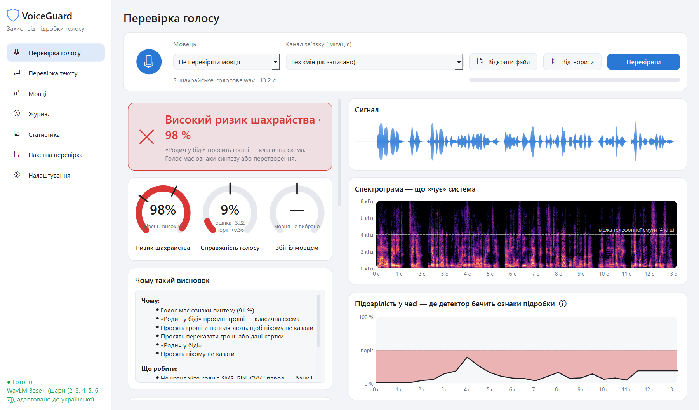
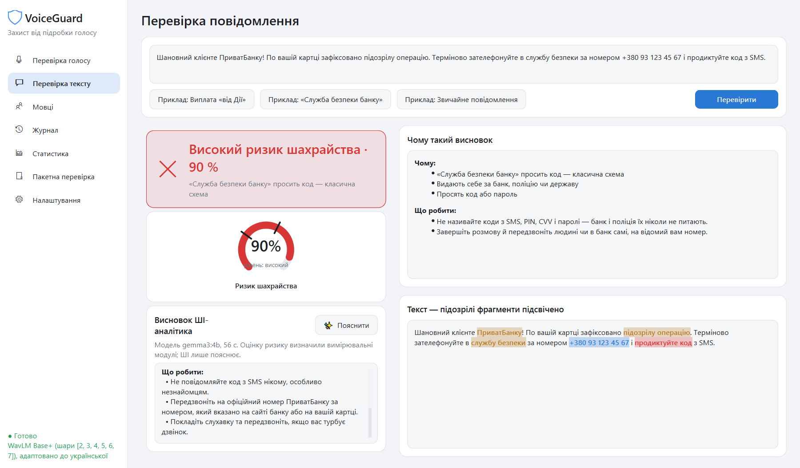
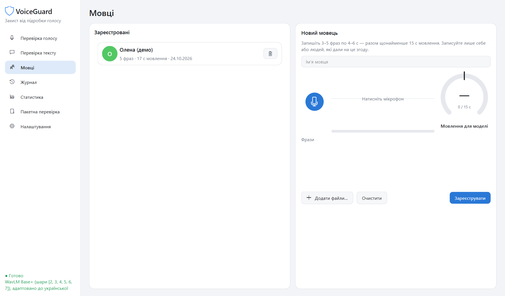

# Приклади запуску

Усі команди виконуються з кореня репозиторію з активованим віртуальним середовищем ([INSTALL.md](INSTALL.md)).
Демонстраційні файли лежать у [demo/](../demo/): справжні записи — диктори Common Voice (CC0), синтезовані — Piper.

| Файл | Що це | Очікуваний результат |
|---|---|---|
| `1_справжнє_голосове.wav` | справжній голос, канал Telegram (Opus 16 кбіт/с) | низький ризик, справжність ≈ 99 % |
| `2_синтезований_голос.wav` | синтез Piper, звичайний зміст | голос синтезований |
| `3_шахрайське_голосове.wav` | синтез, схема «родич у біді» | високий ризик ≈ 98 % |
| `4_дзвінок_банку_синтез.wav` | синтез, «служба безпеки банку», мобільний канал AMR-NB | високий ризик ≈ 96 % |
| `5_справжнє_межовий_випадок.wav` | справжній запис, у якому детектор сумнівається | середній ризик (чесний приклад помилки) |
| `мовець_Олена/реєстрація_1…5.wav` | 5 фраз одного диктора | для реєстрації мовця |
| `мовець_Олена/перевірка_1…2.wav` | інші фрази того самого диктора | збіг із мовцем |
| `інший_мовець/чужий_голос_1…2.wav` | інший диктор | голос справжній, але **не** Олена |

Мовець «Олена (демо)» вже зареєстрований (`app_data/speakers/`).

> Час у прикладах нижче — для одиночного запуску з командного рядка, він містить завантаження моделі Whisper.
> У програмі моделі завантажуються один раз при старті, і перевірка триває 7–14 с.

## 1. Шахрайське голосове (синтезований голос + схема «родич у біді»)

```bash
python examples/check.py audio demo/3_шахрайське_голосове.wav
```

```
Файл:            demo\3_шахрайське_голосове.wav  (13.2 с)
Детектор:        WavLM Base+ (шари [2, 3, 4, 5, 6, 7]), адаптовано до української
Справжність:     9 %  → ознаки синтезу / підробки
Розпізнано:      Мамо, привіт, це я. Я потрапив у дії, мене затримала поліція. Терміну воскинь 20 тисяч на картку адвоката. Ні кому не кажи. Я потім усе поясню.
Ризик:           високий (98 %)
  • Голос має ознаки синтезу (91 %)
  • «Родич у біді» просить гроші — класична схема
  • Просять гроші й наполягають, щоб нікому не казали
  • Просять переказати гроші або дані картки
  • «Родич у біді»
  • Просять нікому не казати
Поради:
  – Не називайте коди з SMS, PIN, CVV і паролі — банк і поліція їх ніколи не питають.
  – Завершіть розмову й передзвоніть людині чи в банк самі, на відомий вам номер.
  – Поставте питання, відповідь на яке знає лише ваш родич, або домовтеся про «кодове слово».
```

Зверніть увагу: розпізнавання мовлення помиляється («у дії» замість «у ДТП»), але правила аналізу змісту стійкі до таких помилок.

## 2. Справжнє голосове

```bash
python examples/check.py audio demo/1_справжнє_голосове.wav
```

```
Файл:            demo\1_справжнє_голосове.wav  (7.0 с)
Детектор:        WavLM Base+ (шари [2, 3, 4, 5, 6, 7]), адаптовано до української
Справжність:     99 %  → справжній голос
Розпізнано:      Обвинувачення не може грунтуватися на доказах одержаних незаконним шляхом, а також на припущеннях.
Ризик:           низький (1 %)
```

## 3. Дзвінок «зі служби безпеки банку» через мобільну мережу

```bash
python examples/check.py audio demo/4_дзвінок_банку_синтез.wav
```

```
Справжність:     29 %  → ознаки синтезу / підробки
Ризик:           високий (96 %)
  • Голос має ознаки синтезу (71 %)
  • «Служба безпеки банку» просить код — класична схема
  • Видають себе за банк, поліцію чи державу
  • Просять код або пароль
```

## 4. Верифікація мовця: «чи це справді Олена?»

Той самий диктор:

```bash
python examples/check.py audio demo/мовець_Олена/перевірка_1.wav --speaker "Олена (демо)" --no-asr
```

```
Справжність:     98 %  → справжній голос
Мовець «Олена (демо)»: збіг (оцінка 0.94, поріг 0.47)
Ризик:           низький (2 %)
Час перевірки:   7.2 с
```

Інша людина — голос живий, але чужий:

```bash
python examples/check.py audio demo/інший_мовець/чужий_голос_1.wav --speaker "Олена (демо)" --no-asr
```

```
Справжність:     99 %  → справжній голос
Мовець «Олена (демо)»: НЕ збігається (оцінка -0.15, поріг 0.47)
Ризик:           високий (70 %)
  • Голос не збігається із заявленою людиною
```

## 5. Реєстрація нового мовця

```bash
python examples/check.py enroll "Олена 2" demo/мовець_Олена/реєстрація_1.wav demo/мовець_Олена/реєстрація_2.wav demo/мовець_Олена/реєстрація_3.wav demo/мовець_Олена/реєстрація_4.wav demo/мовець_Олена/реєстрація_5.wav
python examples/check.py speakers
```

Модель мовця зберігається в `app_data/speakers/<ім'я>.npz`. Рекомендовано 3–5 фраз, сумарно ≥ 15 с мовлення.

## 6. Перевірка текстового повідомлення (SMS, Telegram, Viber)

```bash
python examples/check.py text "Вам нараховано виплату від Дії! Перейдіть: diia-vyplata.xyz і введіть номер картки та CVV"
```

```
Ризик:           високий (96 %)
  • «Виплата чи виграш» в обмін на код
  • «Виплата чи виграш» в обмін на дані картки чи «оплату комісії»
  • Просять код або пароль
  • Просять переказати гроші або дані картки
  • Виграш, виплата або допомога
  • Посилання/номер diia-vyplata.xyz: схоже на «diia», але це не офіційний домен; підозріла доменна зона .xyz
Поради:
  – Не називайте коди з SMS, PIN, CVV і паролі — банк і поліція їх ніколи не питають.
  – Завершіть розмову й передзвоніть людині чи в банк самі, на відомий вам номер.
  – Не переходьте за посиланням і не вводьте там дані картки.
```

Звичайне повідомлення:

```bash
python examples/check.py text "Привіт! Зустрінемося завтра о 10:00 біля бібліотеки, не забудь конспект."
```

```
Ризик:           низький (0 %)
```

## 7. Повний результат у JSON

```bash
python examples/check.py --json audio demo/2_синтезований_голос.wav > result.json
```

Поля: `cm_score`, `cm_threshold`, `cm_confidence` (детектор), `asv_score`, `asv_match` (мовець),
`timeline` (підозрілість у часі), `transcript`, `content` (аналіз змісту), `risk` (`score`, `level`, `reasons`, `advice`), `timings`.

## 8. Використання як бібліотеки Python

```python
from voiceguard import audio
from voiceguard.system import VoiceGuard

vg = VoiceGuard()                                   # завантаження моделей
x = audio.load("demo/3_шахрайське_голосове.wav")    # будь-який формат, → 16 кГц моно
v = vg.check(x, speaker=None)                       # або speaker="Олена (демо)"

print(v.cm_genuine, round(v.cm_confidence, 2))      # False 0.09
print(v.risk["level"], v.risk["reasons"][:2])

r = vg.check_text("Ваша картка заблокована, повідомте код з SMS")
print(r["risk"]["level"])
```

## 9. Десктопна програма

```bash
python VoiceGuard.pyw
```

| Перевірка голосу | Перевірка тексту | Мовці |
|---|---|---|
|  |  |  |

Покроковий сценарій демонстрації — [demo/Сценарій_відео.md](../demo/Сценарій_відео.md).
